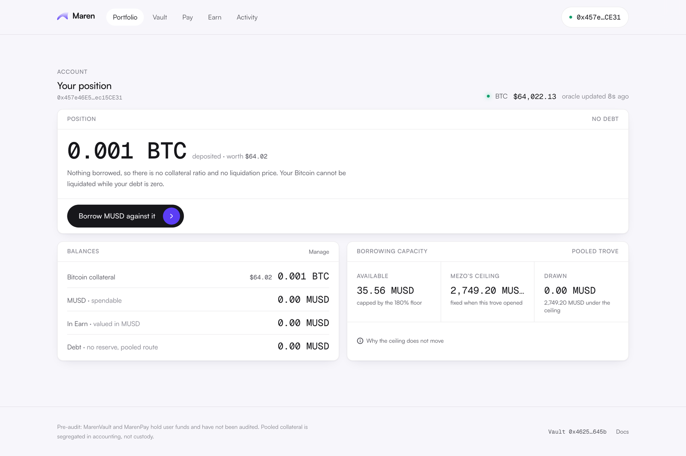
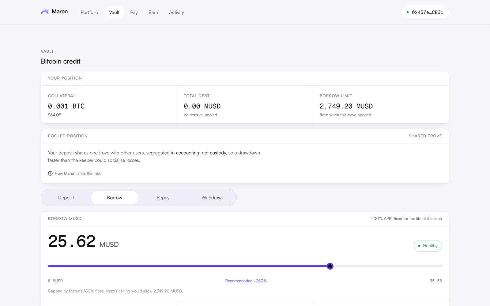
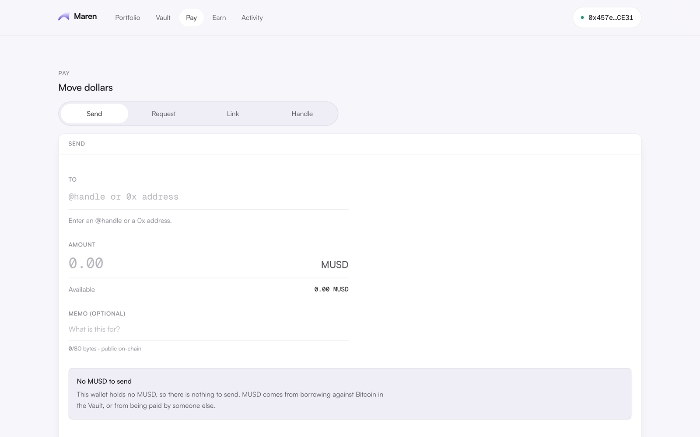

## What Maren is

A consumer borrowing and payments layer for MUSD, built for Mezo and deployed nowhere
else. Users deposit Bitcoin, borrow MUSD against it from 0.001 BTC, and spend it against
`@handles`. Talise stays on Sui; Maren is a separate product under a separate name,
which is our answer to the separate-deployment and exclusivity questions.

## The thesis in three numbers

| Measured 19 August 2026, Mezo mainnet |                           |
| ------------------------------------- | ------------------------- |
| Troves open                           | fewer than thirty         |
| MUSD holders                          | more than 29,000          |
| Collateral to open a trove            | 0.079 BTC, roughly $5,000 |

Tens of thousands hold Mezo's stablecoin; fewer than thirty can mint it, because the
1,800 MUSD minimum net debt sets a $5,000 door. Maren's pooled vault opens the same
product at 0.001 BTC, roughly eighty times lower. Every Maren user is a net-new MUSD
borrower.

## Deployed and checkable today, matsnet (31611)

Five contracts, source-verified on Blockscout, led by MarenVault at
`0x46252B00AB59384518d9dB6D1f210ffF1221645b`. The pooled trove is active inside MUSD's
own TroveManager at **223% ICR** with borrowing enabled, and the `@sele` handle is
registered through commit-reveal. 302 contract tests plus 11 forked against real
matsnet MUSD; 286 on the relayer. The web app reads and writes these contracts live,
including a real user borrow; the iOS app runs the same screens on a mock layer with
identical signatures, pending live wiring.

## The product, as it runs today

Screenshots below are unretouched captures of the web app in a read-only session
against live matsnet. Every figure in them is a contract read;
the borrow offer shown is the preflighted maximum the deployed vault would actually
accept at that moment.

## Not done, stated plainly

No mainnet deployment: gated on audit, deliberately. No audit yet: it is the real
constraint, and it costs more than this grant. The relayer is built and tested but
hosted nowhere, so today users submit their own transactions and the app says so.

## Milestones, and two asks

40% on a verified mainnet deployment, per the terms; the remainder against chain-readable
outcomes: **250 funded positions, $250,000 borrowed**, roughly ten times Mezo's borrower
count. The asks worth more than the money: an introduction to whoever audited MUSD, and
fifty people from the Discord on matsnet in September. Real users find what tests do not.
