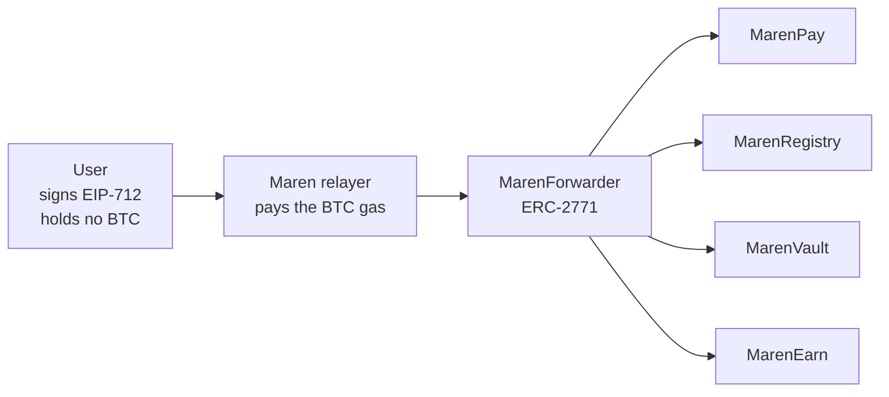
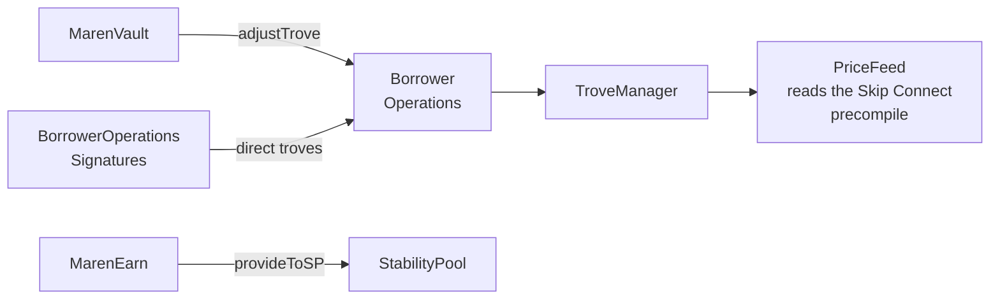
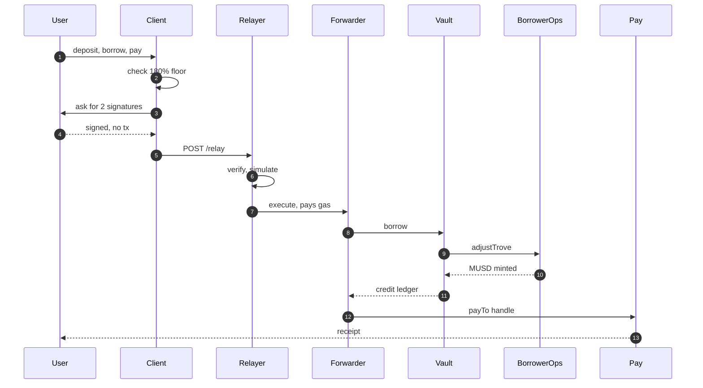

## What this document establishes

The investment thesis (MRN-DOC-001) argues that Mezo's constraint is distribution and
that Maren removes it. This document establishes that Maren can actually be built, by
naming every contract it must call, every place the chain diverges from what a
competent engineer would assume, and every failure mode we have to design around.

Three claims are load-bearing:

1. **The MUSD integration surface is complete and reachable.** Every call Maren needs
   exists on a deployed, verified proxy, and we can compute the hints those calls
   require. Section 4 gives the exact sequences.
2. **The obvious gasless path is a trap on this chain, and the alternative is better.**
   ERC-4337 is deployed on Mezo and structurally unusable. Section 8 explains precisely
   why, and why the path we take instead — EIP-2612 permit plus our own ERC-2771
   forwarder, alongside Mezo's own x402 rail — is both simpler and already proven in
   production by Mezo itself.
3. **The parts that will hurt are known and named.** A pooled trove, one hot key, an
   oracle that reverts on staleness, one endorsed indexer, and a very short list of RPC
   endpoints that actually work. Sections 9 and 11 do not soften any of it.

> [!NOTE]
> This document is written from verified deployed behaviour rather than from
> documentation — including our own. That discipline is not stylistic. Section 6
> lists three places where Mezo's docs promise something the bytecode does not do; had
> we built from the docs, we would have shipped a user-visible lie in each case.

<!-- pagebreak -->

## What Mezo gives us, and what we must build

The single most important fact about this project is how much of it is already done by
somebody else. Maren is an application layer, not a protocol.

| Capability                              | Mezo provides                                                                            | Maren must build                                            |
| --------------------------------------- | ---------------------------------------------------------------------------------------- | ----------------------------------------------------------- |
| BTC-collateralised borrowing            | The entire CDP: `BorrowerOperations`, `TroveManager`, liquidation engine, Stability Pool | Nothing. We call it.                                        |
| Stablecoin                              | MUSD, with EIP-2612 `permit` and permit2 support                                         | Nothing.                                                    |
| BTC/USD price                           | Consensus-level oracle exposed as a chain precompile                                     | Staleness handling and an explicit unavailable state        |
| Signed borrower operations              | `BorrowerOperationsSignatures`, EIP-712 for every borrower action                        | Nothing, for direct troves. We call it rather than wrap it. |
| Gasless payment settlement              | x402 settlement proxy, live on both networks                                             | Interoperation, not replacement                             |
| Batched reads                           | Multicall3 at the canonical address on both networks                                     | A corrected chain definition, because viem's omits it       |
| Sub-minimum borrowing                   | —                                                                                        | `MarenVault`: a pooled trove with per-user accounting       |
| Meta-transactions for our own contracts | —                                                                                        | `MarenForwarder` + relayer                                  |
| Human-readable payment identity         | —                                                                                        | `MarenRegistry`                                             |
| Consumer payments surface               | —                                                                                        | `MarenPay`                                                  |
| Stability Pool yield, tokenised         | —                                                                                        | `MarenEarn`, an ERC-4626 wrapper                            |
| Indexing                                | Goldsky support, but no public subgraph                                                  | Our own subgraph                                            |

Five contracts and one relayer. Everything financial that could be delegated to
audited, already-deployed Mezo code is delegated to it.

## Verified chain facts

Everything in this section was confirmed against live RPCs on 2026-08-15. It is
reproduced here because the published sources disagree with reality often enough that
a table of what is actually true has real value.

| Fact          | Mainnet                                          | Matsnet                                  |
| ------------- | ------------------------------------------------ | ---------------------------------------- |
| Chain ID      | 31612                                            | 31611                                    |
| Chain ID, hex | 0x7b7c                                           | 0x7b7b                                   |
| Gas token     | BTC                                              | BTC                                      |
| Decimals      | 18                                               | 18                                       |
| Primary RPC   | `https://jsonrpc-mezo.boar.network`              | `https://rpc.test.mezo.org`              |
| Fallback RPC  | `https://mainnet.mezo.public.validationcloud.io` | —                                        |
| Explorer      | `https://explorer.mezo.org`                      | `https://explorer.test.mezo.org`         |
| Explorer API  | `https://api.explorer.mezo.org/api`              | `https://api.explorer.test.mezo.org/api` |
| Multicall3    | `0xcA11bde05977b3631167028862bE2a173976CA11`     | same address, also deployed              |
| Base fee      | 1,300,000 wei                                    | —                                        |
| Gas limit     | 10,000,000                                       | —                                        |

Two details in that table cost real time to establish.

**BTC has 18 decimals here, not 8.** Mezo is an EVM chain and BTC is its gas token, so
it follows the EVM convention. Every balance, every gas estimate, and every `msg.value`
is a 1e18-scaled quantity. Reusing a Bitcoin-side 1e8 assumption produces errors of ten
orders of magnitude, silently, in the direction of thinking the user is rich.

**Multicall3 is deployed, at the canonical cross-chain address, on both networks.** We
confirmed 7,619 bytes of code at that address on 31612 and 31611, and bisected its birth
block to exactly **351760** — the address is empty at 351759. This matters because
viem's bundled chain definition omits `multicall3` for Mezo mainnet, so every batched
read silently degrades to individual calls, or breaks.

### Mezo is not an OP-stack L2

This is the fact that explains most of the ecosystem gaps. Mezo is a **Cosmos SDK +
CometBFT chain running an EVM module** — `Mezod/12.0.0`, an Evmos fork embedding
go-ethereum `v1.16.9-mezo2`. It is not an Optimism, Arbitrum, or Polygon CDK rollup, and
it does not inherit any of the vendor support those stacks get automatically. When a
tooling vendor says "we support every EVM chain", they generally mean every chain built
on the four stacks they have already integrated.

That architecture also produces a handful of EVM divergences worth knowing before you
debug them at 2am:

| Behaviour                         | On Mezo                                                              |
| --------------------------------- | -------------------------------------------------------------------- |
| `SELFDESTRUCT`                    | Disabled                                                             |
| `PREVRANDAO`                      | Returns 0                                                            |
| Blob transactions (type 3)        | Rejected                                                             |
| `requestsHash` in block responses | Omitted, although Prague is active                                   |
| `debug_traceCall`                 | Not implemented — absent from the mezod source, not merely unexposed |

The last row is the one that decides Maren's entire gasless architecture. Section 8.

### Endpoint selection is an engineering decision

Mezo's RPC landscape is thin enough that choosing an endpoint is a design decision
rather than a configuration detail.

**Three published hosts do not exist.** `rpc.mezo.org` and `testnet-rpc.mezo.org` are
listed in Mezo's own documentation and return NXDOMAIN, as does
`testnet-explorer.mezo.org`. A pull request correcting these is prepared. Separately,
none of Alchemy, QuickNode, Ankr, Infura, or Chainstack support Mezo at all, which
leaves a short list of endpoints that work.

**The endpoints that do exist are transiently unreliable in a way that is easy to
misdiagnose.** During development, one endpoint returned
`-32601 the method does not exist/is not available` for `eth_call`, `eth_getLogs`, and
`eth_estimateGas` across an entire probe sweep, and then served all three correctly an
hour later. A degraded backend behind a load balancer answering `-32601` is
indistinguishable, from a single probe, from an endpoint that genuinely lacks the
method. On this chain a `-32601` is therefore not evidence of a missing capability, and
one probe is not evidence of anything.

That shapes the architecture, not just the configuration. Maren's chain configuration
lists several endpoints and every client fails over across them rather than pinning one
URL. The relayer additionally runs a boot-time capability preflight and refuses to start
if no configured endpoint survives it.

```typescript
// packages/sdk/src/chains.ts — an endpoint is usable only if it serves the methods an
// application actually needs, and it is re-checked rather than trusted once.
const CERTIFYING_CALLS = ['eth_call', 'eth_getLogs', 'eth_getBlockByNumber'] as const;

// A chain-ID check proves a host is reachable. It does not prove it is serving.
// Clients fail over across endpoints; the relayer preflights and refuses to boot
// when none of them pass.
```

> [!VERIFIED]
> `TroveManager.getTroveOwnersCount()` → `26`, executed against
> `https://jsonrpc-mezo.boar.network` on 2026-08-15. This is simultaneously the
> endpoint certification and the trove count the investment thesis rests on.

There is no public WebSocket endpoint on Mezo that we have been able to verify. Maren's
indexing design assumes polling and webhooks, not subscriptions, which is section 9.

### Precompiles and standard infrastructure

| Component                | Address                                      | Status                             |
| ------------------------ | -------------------------------------------- | ---------------------------------- |
| BTC gas-token precompile | `0x7b7C000000000000000000000000000000000000` | Live                               |
| Price oracle precompile  | `0x7b7c000000000000000000000000000000000015` | Live, Skip Connect                 |
| RIP-7212 `P256VERIFY`    | `0x0000000000000000000000000000000000000100` | Active                             |
| Multicall3               | `0xcA11bde05977b3631167028862bE2a173976CA11` | Deployed, birth block 351760       |
| Permit2                  | canonical                                    | Deployed                           |
| CREATE2 deployer         | canonical                                    | Deployed                           |
| ERC-4337 EntryPoint v0.7 | `0x0000000071727De22E5E9d8BAf0edAc6f37da032` | Deployed and inert — see section 8 |
| x402 settlement proxy    | `0x402085c248EeA27D92E8b30b2C58ed07f9E20001` | Live on both networks              |

The active `P256VERIFY` precompile is worth one line beyond the table: on-chain
passkey and WebAuthn signature verification is native and cheap on Mezo. For a consumer
Bitcoin product, biometric authorisation without a browser extension is a real unlock,
and it is available here without a bespoke verifier contract.

## The MUSD integration surface

MUSD is a fork of Threshold USD, itself a fork of Liquity v1. All core contracts are
`TransparentUpgradeableProxy`; we always integrate against the proxy.

| Contract                     | Mainnet (31612)                              |
| ---------------------------- | -------------------------------------------- |
| MUSD                         | `0xdD468A1DDc392dcdbEf6db6e34E89AA338F9F186` |
| BorrowerOperations           | `0x44b1bac67dDA612a41a58AAf779143B181dEe031` |
| BorrowerOperationsSignatures | `0xB57ab578BF20b3e318f3EFAA587C51DBccE5df7a` |
| TroveManager                 | `0x94AfB503dBca74aC3E4929BACEeDfCe19B93c193` |
| StabilityPool                | `0x73245Eff485aB3AAc1158B3c4d8f4b23797B0e32` |
| PriceFeed                    | `0xc5aC5A8892230E0A3e1c473881A2de7353fFcA88` |
| SortedTroves                 | `0x8C5DB4C62BF29c1C4564390d10c20a47E0b2749f` |
| HintHelpers                  | `0xD267b3bE2514375A075fd03C3D9CBa6b95317DC3` |
| InterestRateManager          | `0x4a453700d157717Fe02fB62E7700ED7845048285` |
| GovernableVariables          | `0x560AC4Ea44Fb7EB2D4d3c00608CB1CAb2613d389` |

Matsnet equivalents are in `packages/sdk/src/addresses.ts`. All fifteen addresses were
verified three independent ways: the `mezo-org/musd` deployment artifacts, the
OpenZeppelin proxy manifest (14/14 match), and live `eth_getCode` plus functional calls.

### Call sequences

Collateral is native BTC passed as `msg.value`. There is no ERC-20 approval step for
collateral, and — importantly — **no `_maxFeePercentage` parameter anywhere**.

```solidity
// Open. msg.value is the BTC collateral; _debtAmount is NET debt, minimum 1,800e18.
// Total debt becomes _debtAmount + 200e18 gas compensation.
function openTrove(uint256 _debtAmount, address _upperHint, address _lowerHint) external payable;

// Adjust. Either msg.value > 0 or _collWithdrawal > 0 — both positive reverts.
function adjustTrove(
    uint256 _collWithdrawal,
    uint256 _debtChange,
    bool    _isDebtIncrease,
    address _upperHint,
    address _lowerHint
) external payable;

// Narrower forms of the same adjustment, all hint-bearing.
function addColl(address _upperHint, address _lowerHint) external payable;
function withdrawColl(uint256 _amount, address _upperHint, address _lowerHint) external;
function withdrawMUSD(uint256 _amount, address _upperHint, address _lowerHint) external;
function repayMUSD(uint256 _amount, address _upperHint, address _lowerHint) external;

// Close. Requires the caller to hold the full debt less the 200e18 gas compensation.
function closeTrove() external;
```

Every one of those calls needs an insertion hint, because `SortedTroves` maintains the
trove list ordered by nominal ICR and inserting without a hint is O(n) in gas.

```typescript
// Hint computation. HintHelpers.getApproxHint does a seeded random walk; SortedTroves
// turns that approximation into the exact neighbours.
const numTroves = await sortedTroves.read.getSize();
const numTrials = Math.ceil(Math.sqrt(Number(numTroves))) * 15;

const [approxHint] = await hintHelpers.read.getApproxHint([
  nominalIcr,
  BigInt(numTrials),
  randomSeed,
]);

const [upperHint, lowerHint] = await sortedTroves.read.findInsertPosition([
  nominalIcr,
  approxHint,
  approxHint,
]);
```

With 26 troves on mainnet, `numTrials` is 75 and the search is effectively free. This is
a case where the current smallness of Mezo is an operational advantage: hint computation
is a solved cost today, and `MarenVault` holds one trove regardless of how many users
sit inside it, so Maren's hint cost does not grow with Maren's user count.

Reads for position health come from `TroveManager.getEntireDebtAndColl`, which returns
six values, and from `getTroveMaxBorrowingCapacity`, which is the real borrow limit.
Both are covered in the next section, because both are places a ported Liquity frontend
breaks.

### Position math, and which way it rounds

The headline number in MRN-DOC-001 — the collateral required to reach the 1,800 MUSD
minimum — is not a calculation performed in a document. It is the output of
`collateralRequiredFor()` in `packages/sdk/src/position.ts`, executed against the live
oracle price of $63,071.83, and asserted by a test that requires the result to fall
between 0.078 and 0.080 BTC:

| Quantity                | Value                        |
| ----------------------- | ---------------------------- |
| Minimum net debt        | 1,800 MUSD                   |
| Gas compensation        | 200 MUSD                     |
| Minimum total debt      | 2,000 MUSD                   |
| Target collateral ratio | 250%                         |
| BTC price used          | $63,071.83                   |
| **Collateral required** | **0.079346 BTC ($5,004.50)** |
| Maren pooled floor      | 0.001 BTC                    |
| Reduction               | 79.3×                        |

The reduction is 79.3×. We write "roughly eighty times" and never round it to 100×,
for the same reason the position math itself rounds in one direction only.

**Collateral ratios round down. Liquidation prices and collateral requirements round
up.** A position can therefore never display as safer than it is. `179.99%` renders as
`179.9%`, never `180%`, because 180% is the borrow threshold and the flattering rounding
would tell a user they can act when they cannot. BRAND.md §8 states the rule; the SDK
enforces it at the point where the number is produced rather than at the point where it
is displayed, so no client can accidentally round the wrong way.

## The seven Liquity divergences

MUSD is a Liquity v1 descendant, and that is a trap. It is close enough that a ported
frontend compiles and far enough that it fails in production. These seven divergences
are recorded in `packages/sdk/src/constants.ts` because they are integration-critical,
and each one was found by reading the deployed contracts.

### No `_maxFeePercentage` on any borrower operation

Liquity's `openTrove`, `adjustTrove`, and `withdrawLUSD` all take a slippage guard
because Liquity's borrowing fee floats with a decaying base rate. MUSD's rates are flat
and timelocked, so the guard is unnecessary — and the parameter is simply gone.

**Why it breaks a port:** the ABI does not match. A ported frontend encodes an extra
argument and every call reverts on decode, with no useful error. This is the first thing
that will happen to anyone who pastes a Liquity ABI into a Mezo project.

### `PriceFeed.fetchPrice()` is `view` and reverts on staleness

It reverts if the oracle is more than **60 seconds** stale. There is **no
`lastGoodPrice()` getter**; the `LastGoodPriceUpdated` event exists but is vestigial.

**Why it breaks a port:** Liquity frontends call `lastGoodPrice()` for display and treat
the price as always available. On Mezo that function does not exist, and the function
that does exist is a revert risk on every borrow, adjust, redeem, and liquidate path.
A frontend without an explicit "price unavailable" state will show a blank or a zero
and let the user submit a transaction that cannot succeed.

### `maxBorrowingCapacity` is a Mezo-only per-trove ceiling

Each trove carries a borrowing ceiling fixed at the price prevailing when the trove was
opened. **Adding collateral does not raise it.** Only `refinance()` does.

**Why it breaks a port:** every Liquity frontend derives the borrow limit from ICR and
current price. On Mezo that number is wrong — usually too high — so the interface offers
the user a borrow that will revert. The real limit is
`TroveManager.getTroveMaxBorrowingCapacity()`, and it must be displayed as the limit.

### No base rate accumulator and no redemption-fee decay

There is no `baseRate`, no `getRedemptionRateWithDecay()`, and no
`REDEMPTION_FEE_FLOOR()`. The redemption rate is a flat, governable 0.75%.

**Why it breaks a port:** those getters are missing, not merely constant. Any redemption
UI that calls them fails at the ABI, and any fee projection that models decay is wrong.

### Recovery Mode does not expand liquidations

In Liquity, Recovery Mode allows liquidation of troves up to the 150% critical ratio. In
MUSD, **the liquidation threshold stays 110% in both modes.** Recovery Mode only forces
new loans to open at ≥150% and blocks `refinance()`.

**Why it breaks a port:** this is the most dangerous divergence, because it fails in the
direction of alarming users. A ported frontend entering Recovery Mode will tell a user
at 130% that they are about to be liquidated when they are not. It also misleads a
liquidation bot into attempting liquidations that revert.

### Collateral is native BTC, not an ERC-20

Collateral arrives as `msg.value`. There is no approval step and no collateral token
address.

**Why it breaks a port:** a ported flow shows an "approve collateral" step that cannot
be satisfied, and encodes collateral as a call argument rather than as value, so the
trove opens with zero collateral or the call reverts.

### Debt is split into principal and interest

`getEntireDebtAndColl` returns **six** values — `coll`, `principal`, `interest`,
`pendingCollateral`, `pendingPrincipal`, `pendingInterest` — where Liquity v1 returns
four.

**Why it breaks a port:** tuple destructuring silently misaligns. The value a ported
frontend labels "collateral" is a different quantity entirely, and it will render a
confident, wrong number on the user's position screen. Interest must be added to
principal to get total debt; treating `principal` as the debt understates what the user
owes.

> [!WARNING]
> Six of these seven produce a revert, which is survivable. Two of them — the Recovery
> Mode threshold and the six-value debt tuple — produce a _plausible wrong number_ on a
> screen a user makes financial decisions from. Those are the ones that matter, and they
> are the reason Maren reads the deployed contracts rather than a reference
> implementation.

## Three places the docs and the code disagree

Offered to the Mezo team as findings. In each case Maren follows the code, and records
the disagreement so nobody later "fixes" our implementation to match a document. The
first two are in the `mezo-org/documentation` repository, at `users/borrow/fees.md`
lines 13 and 33 and `users/borrow/index.md` line 30.

### The borrower redemption-fee waiver does not exist

Mezo's documentation states that borrowers with an outstanding loan pay a zero
redemption fee. The deployed `TroveManager` applies `getRedemptionRate()`
unconditionally. `isAccountFeeExempt` is defined on `GovernableVariables` and referenced
**only from `BorrowerOperations`** — three call sites, all on the borrowing path. It is
never consulted by `TroveManager` on the redemption path.

**Consequence:** do not promise a borrower redemption-fee waiver in a user interface. A
user who acts on that promise loses 0.75% in BTC.

### The refinancing fee is not 0.1%

The docs list the refinance fee as 0.1%. The code sets `refinancingFeePercentage = 20`
and computes `amount = (refinancingFeePercentage * oldDebt) / 100` — 20% of old net debt
— then applies the 0.1% borrowing fee to _that_ amount. The effective cost is
approximately **0.02% of old net debt**, an order of magnitude cheaper than documented.

**Consequence:** the documented number is wrong in the user's favour, which is the less
dangerous direction, but a product that quotes 0.1% is overcharging its own users'
expectations and under-recommending a useful operation. Since `refinance()` is the only
way to raise `maxBorrowingCapacity`, this matters for the borrow-limit UX.

### "100% Bitcoin-backed" is true of the CDP, not of circulating MUSD

Total MUSD supply is approximately **31.08 million**. Trove-backed debt is approximately
**1.6 million**, plus an outstanding PCV bootstrap loan of approximately **15.0 million**.
The remainder sits in protocol-owned strategies and the Wormhole NTT bridge.

**Consequence:** the CDP portion is fully Bitcoin-backed and that claim is defensible.
A blanket "every MUSD is backed by Bitcoin" statement is not, and Maren does not repeat
it to users. This is also the clearest illustration of the thesis's central number: 31.08
million MUSD and 29,360 holders sit above a CDP with 26 troves in it.

## Maren's contract architecture

Solidity 0.8.28, Foundry, OpenZeppelin v5. Five contracts, in `packages/contracts/src/`.

The system is easiest to read as two paths: how a user action gets in, and where it
settles. **Getting in** — the user signs, the relayer pays, the forwarder dispatches:



**Settling** — Maren's contracts call Mezo's, and every price ultimately comes from the
same precompile the liquidation engine uses:



### `MarenForwarder` — gasless execution

An ERC-2771 trusted forwarder built on OpenZeppelin's `ERC2771Forwarder`. Users sign an
EIP-712 `ForwardRequest`; the relayer submits it and pays the BTC gas. Domain
`Maren Forwarder`, version `1`. Replay protection is a per-signer nonce plus a deadline.
Only Maren contracts trust it; it is never a general-purpose relayer.

### `MarenRegistry` — handles

`@sele` to address. Commit-reveal registration to stop front-running, 3–32 characters
from `[a-z0-9_]`, one primary handle per address, reverse resolution for display.

### `MarenPay` — payments

`ERC2771Context`, operating on MUSD. `pay(to, amount, memo)` with an on-chain memo
event; `payTo(handle, amount, memo)` resolving through the registry;
`createRequest`/`fulfillRequest`; `createLink`/`claimLink` for claimable links, where
the claimer needs no prior relationship and no BTC; and `split(recipients[], amounts[],
memo)` for one signature to many recipients. No custody — MUSD moves wallet to wallet
via `transferFrom` under the user's own permit.

### `MarenVault` — pooled Bitcoin credit

The differentiator, and the risk. One large, conservatively managed trove; users hold a
proportional claim with a per-user ledger.

| Property                      | Value     |
| ----------------------------- | --------- |
| Minimum deposit               | 0.001 BTC |
| Protocol MCR                  | 110%      |
| Maren internal liquidation CR | 140%      |
| Maren target CR               | 250%      |
| Maren minimum healthy CR      | 180%      |
| Internal liquidation penalty  | 5%        |

A keeper tops up collateral, repays debt, and internally liquidates unhealthy users by
seizing collateral at a 5% penalty and repaying their share of pooled debt. Users can
always exit by repaying their debt share and withdrawing collateral. If the pooled trove
would breach policy, **borrowing halts before withdrawal does** — exits stay open when
entries close.

### `MarenEarn` — yield

An ERC-4626 vault over the MUSD Stability Pool. It sweeps the BTC liquidation gains the
Stability Pool pays out, converts them, and compounds them back into MUSD so
`totalAssets()` grows for shareholders.

> [!WARNING]
> The MUSD Stability Pool has **no token emissions**. Yield is liquidation gains only,
> which makes it lumpy and not an APY anyone may advertise as fixed. Maren displays
> trailing realised yield, labelled as backward-looking. Any product presenting a
> forward APY here is presenting a number it invented.

## The gasless design

This section exists because the obvious answer is wrong, and being able to say why is
worth more than the answer itself.

### ERC-4337 is a dead end on Mezo

EntryPoint v0.7 **is** deployed at `0x0000000071727De22E5E9d8BAf0edAc6f37da032` —
32,073 bytes, byte-identical to the Ethereum L1 deployment. Everything downstream of it
is absent:

| Check                                                                    | Result                    |
| ------------------------------------------------------------------------ | ------------------------- |
| UserOperations ever processed                                            | Zero                      |
| Contract verified on the explorer                                        | No                        |
| Blockscout account-abstraction indexer                                   | `501 Service is disabled` |
| `debug_traceCall` on Mezo RPCs                                           | Not implemented           |
| Pimlico, Biconomy, ZeroDev, Alchemy, Candide, Coinbase Paymaster, Gelato | Not listed                |
| OpenZeppelin Defender hosted relaying                                    | Retired 2026-07-01        |

The root cause is one row of that table. Every ERC-7562-compliant bundler validates a
UserOperation by tracing it to enforce the opcode and storage-access rules, and that
requires `debug_traceCall`. Mezo's RPCs do not implement it — it is absent from the
mezod source, not merely unexposed. **No compliant bundler can run against Mezo**, which
is why no vendor lists it and why an EntryPoint with 32KB of correct bytecode has
processed nothing.

A team that picked ERC-4337 from a diagram would spend weeks discovering this. It is a
deployed contract, on the canonical address, with the right bytecode, and it does not
work.

### What we do instead

Three live paths, in the order Maren uses them.

**1. EIP-2612 permit plus our own ERC-2771 relayer.** This is Maren's primary mechanism,
and it is exactly what Mezo itself runs in production for its "Get Gas" feature. No
bundler, no vendor, no EntryPoint. MUSD supports EIP-2612 `permit`, so a first-time user
can approve and transact in one signed action holding zero BTC. Implementation cost is
1–2 weeks, and every component is code we control and can audit.

**2. Interoperate with x402.** Mezo operates its own gasless payment rail: the x402
settlement proxy at `0x402085c248EeA27D92E8b30b2C58ed07f9E20001` — 5,829 bytes, the same
address on both networks — with a facilitator at `https://facilitator.vativ.io` and the
`@x402/evm` SDK at version 2.15.0 or later. Because MUSD supports both permit2 and
EIP-2612, a buyer authorises a payment with a single EIP-712 signature: no approval
transaction, no gas. Maren interoperates with this rather than competing with it. A
payment rail that the chain operates and that Maren's users can settle against is an
asset, not a rival.

**3. EIP-7702, as the upgrade path.** EIP-7702 is **live on Mezo mainnet from block
9,275,000**, with both Prague and Osaka active. mezod ships a dedicated specification
whose stated intent is that sponsored-transaction flows work "without external
relayers". That is the path to transaction batching and session keys, and combined with
the active `P256VERIFY` precompile it is also the path to passkey-authorised accounts.
Maren does not depend on it for launch; it is the direction of travel once the simpler
mechanism is live and audited.

### Why we call Mezo's signature contract rather than wrap it

Mezo ships `BorrowerOperationsSignatures`, an EIP-712 signed variant of every borrower
operation. For **direct** troves, Maren calls Mezo's contract directly rather than
routing through `MarenForwarder`.

The reasoning is trust surface, not convenience. Wrapping it would mean a user's
direct-trove position depends on Maren's forwarder being correct. Calling it means the
position depends only on Mezo's already-deployed, already-reviewed contract, and Maren's
forwarder covers only Maren-native actions — Pay, Earn, Registry, and the pooled Vault.
A user with a direct trove can walk away from Maren entirely and their position is
untouched. That property is worth more than code reuse.

### A gasless borrow-and-pay, end to end



Reading the numbered steps against the prose: the client checks Maren's own 180% policy
floor before it asks for anything (2); the user produces an EIP-712 `ForwardRequest` and
an EIP-2612 `permit` and no transaction at all (3–4); the relayer verifies the signature
against its allowlist and budget and simulates by `eth_call` before spending gas (6); the
forwarder resolves the true sender so `MarenVault` credits the right ledger (8, 11); and
the user ends holding MUSD and a receipt without ever having held BTC (13).

The relayer's guarantees are narrow and worth stating precisely. It will only relay to
Maren contracts, only for known selectors. It rate-limits per address and per IP, and
carries a per-address daily sponsorship budget. Its policy is that the first 25 actions
per address are free, after which a small fee is taken in MUSD **inside the same
transaction**, so a new user is never blocked at the door. It manages nonces under a
per-key mutex and bumps replacement fees on stuck transactions. It never holds user
funds: compromise of the relayer key costs Maren its gas float, not a user's money.

## Off-chain

### Indexing

Mezo has **no public subgraph** — `mezo-org/subgraphs` returns 404 — and is not in The
Graph's registry. Envio HyperSync and Alchemy webhooks do not cover it either.

**Goldsky is the only indexer Mezo endorses**, with network slugs `mezo` and
`mezo-testnet`, and it is what Maren uses. Blockscout REST v2 at
`https://api.explorer.mezo.org/api/v2` covers ad-hoc reads and backfill verification —
note the `api.` subdomain, because `explorer.mezo.org/api/...` returns 404.

This is a genuine single point of dependency and we treat it as one. Every Maren
contract emits events sufficient to rebuild all application state from chain history
alone, so a Goldsky outage degrades Maren to slower reads via Multicall3 and Blockscout
rather than breaking it. No user-visible balance is ever sourced only from the index;
positions and balances are read from chain state, and the index serves history, search,
and notifications.

### Price handling

`PriceFeed.fetchPrice()` reads the Skip Connect oracle — Mezo's own consensus-level
`x/oracle` Cosmos module, exposed as the precompile at
`0x7b7c000000000000000000000000000000000015`. It is Chainlink-`AggregatorV3`-shaped and
implements only `decimals()` and `latestRoundData()`; `description()` reverts. It
returns 18 decimals, and on 2026-08-15 it returned BTC at **$63,071.83**, updated
seconds earlier.

It is **not Chainlink and not Pyth**. It is secured by Mezo's validator set. That is a
different trust model from an independent third-party oracle network, and it belongs in
the risk section of any honest document.

> [!RISK]
> Pyth **is** deployed on Mezo, at `0x2880aB155794e7179c9eE2e38200202908C17B43`, and it
> is not a usable substitute: its feeds are approximately **28 days stale** and ETH/USD
> reverts outright. A developer who reaches for the familiar oracle because it is
> present will build liquidation math on a month-old price. Maren uses the precompile,
> the same source MUSD's own liquidation engine uses, because using a different price
> from the protocol that liquidates you is its own category of bug.

The 60-second staleness revert propagates into every borrow, adjust, redeem, and
liquidate path. Maren's handling: both clients have an explicit "price feed unavailable"
state; we never render a stale price as live; the keeper treats a price revert as a
hold rather than an error and retries with backoff; and the pooled vault's 140% internal
ratio exists partly to absorb the window in which no liquidation can execute because
nobody can read a price.

### Failure modes

| Failure                      | Detection                               | Response                                                                       |
| ---------------------------- | --------------------------------------- | ------------------------------------------------------------------------------ |
| Oracle stale beyond 60s      | `fetchPrice()` reverts                  | Clients show "price unavailable"; borrowing disabled; keeper holds and retries |
| Certified RPC degrades       | Certification probe fails on `eth_call` | Fail over to the second certified endpoint                                     |
| Goldsky lag or outage        | Indexed head trails chain head          | History degrades; balances and positions still read from chain via Multicall3  |
| Relayer key compromised      | Budget anomaly, unexpected selector     | Revoke the forwarder's relayer allowlist entry; user funds unaffected          |
| Relayer out of BTC           | Balance floor alarm                     | Sponsorship pauses; users may still self-submit with their own BTC             |
| Pooled trove approaches 140% | Per-block keeper check                  | Halt new borrowing, top up collateral, then internally liquidate               |
| MUSD proxy upgraded          | Implementation address changes          | Integration paused pending review; we monitor the proxy admin                  |

## Delivery plan

| Stage                  | Network        | Gate                                                                                                                                  |
| ---------------------- | -------------- | ------------------------------------------------------------------------------------------------------------------------------------- |
| 1. Build and integrate | matsnet, 31611 | All five contracts deployed, a pooled trove seeded, the full borrow-pay-earn-exit loop run end to end                                 |
| 2. Audit               | —              | Third-party audit of `MarenVault` and `MarenForwarder` — the two contracts that carry risk — with findings and remediations published |
| 3. Capped mainnet      | mainnet, 31612 | Vault deployed with a hard cap; the cap is raised only as the position proves out                                                     |

Mezo Market listing requires MUSD integration, a third-party audit submitted to the
Supernormal Foundation, and a live mainnet deployment. Deployment itself is
permissionless, so nothing in this plan waits on a Mezo approval.

The proxy admin for Maren's own upgradeable components sits behind a timelock and a
multisig from deployment day one, not as a later hardening step.

## What could go wrong, and what we would do

**The pooled trove takes a loss.** The design risk. A BTC drawdown faster than the keeper
can act socialises losses across pooled depositors, because collateral is segregated in
accounting rather than in custody. Mitigations are the 140%-versus-110% buffer, per-block
keeper checks, halting borrowing before withdrawals, and an insurance buffer funded from
vault fees. If it happens anyway, the response is disclosed loss allocation by the
published per-user ledger, the vault paused for entries, exits kept open, and a public
post-mortem. Users above the protocol minimum are steered to direct troves specifically
so the population exposed to this is the population that has no alternative.

**The relayer key is compromised.** The blast radius is Maren's gas float, by design. The
forwarder's allowlist is revocable, so the response is revocation, rotation, and refill.
No user signature becomes usable to an attacker, because every action is bound to the
user's own EIP-712 signature and MUSD moves under the user's own permit.

**MUSD is upgraded underneath us.** Every core MUSD contract is a transparent proxy
controlled by Mezo's multisig. We monitor implementation addresses and pause integration
on change pending review. We cannot mitigate this further, and we would rather write
that down than imply otherwise.

**The oracle stops.** Borrowing and liquidation both stop, for Maren and for the protocol
alike. Maren's exposure is that the pooled vault cannot be defended during the window.
The 140% internal ratio is sized to survive a plausible outage rather than a worst case,
and we will publish the assumption rather than let it be inferred.

**Goldsky becomes unavailable.** Degraded history and search, functioning core product,
per the indexing section. Every contract emits enough to rebuild state from chain
history, so the recovery path is a reindex, not a data loss.

**Mezo's tooling gaps get worse before better.** The realistic version of this risk is
that we continue to carry chain-integration work that a mature ecosystem would give us
for free. Our answer is to keep publishing what we find — the corrected viem chain
definition, the endpoint certification rule, the divergence list, and the three doc/code
discrepancies in section 6 — so the next team pays less than we did.

**We are wrong about demand.** The falsifiable version of the thesis is milestone M2 in
MRN-DOC-001: 100 distinct addresses holding a pooled position below the 1,800 MUSD
protocol minimum. If sub-minimum borrowing demand does not exist on Mezo, that number
will not move, and it will not move early. It is deliberately the milestone that is
hardest to fake and quickest to disprove.
